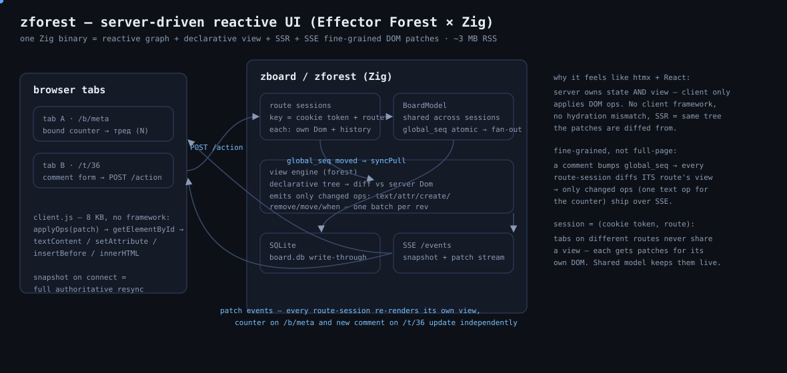

# zforest

Server-driven UIs in Zig: the `zefx` reactive graph core plus `forest`, a
fine-grained DOM patch layer, served by a minimal `std.http` server with a
vanilla JS patch client. Four apps share the transport:

- **`zforest`** — the Todo demo (per-session model, no database).
- **`zboard`** — an anonymous message board (static boards, threads,
  nested tree comments) over a shared SQLite-backed model.
- **`zmon`** — a live ops dashboard (mock request stream, windowed
  rps/error/latency stats, 384-line request-log firehose, inject +
  storm buttons, traffic sliders, SVG sparklines) on **fine-grained
  live bindings**: the view tree is built once per session and every
  bound leaf subscribes to its store, so updates emit patch ops with
  no rebuild+diff (`forest.bindTree`).
- **`zcar`** — a service-booking demo (brand → model → year cascade,
  vehicle specs, service catalogue by category, context upsells, combo
  discounts, booking form + history) — exercises keyed lists and
  conditional subtrees on the diff path.
- **`zmeta-demo`** — the `zmeta` meta-framework demo: file-based
  routes, typed params, generated action dispatch, `Session(Deps)`
  skeleton. See [docs/getting-started.md](docs/getting-started.md).

<p align="center">
  
</p>

## Run

```sh
zig build        # produces zig-out/bin/{zforest,zboard,zmon,zcar,zmeta-demo}
zig build run    # serves the todo app on http://127.0.0.1:8080
zig build run-board 8081 127.0.0.1 board.db  # board on :8081, file db
zig build run-mon 8082 127.0.0.1             # dashboard on :8082
zig build run-car 8083 127.0.0.1             # booking demo on :8083
zig build run-demo 8084 127.0.0.1            # zmeta demo on :8084
./zig-out/bin/zforest [port] [bind-ip]
./zig-out/bin/zboard   [port] [bind-ip] [db-path]   # db-path default ":memory:"
./zig-out/bin/zmon     [port] [bind-ip]
./zig-out/bin/zcar     [port] [bind-ip]
./zig-out/bin/zmeta-demo [port] [bind-ip]
zig build test   # engine, forest, session, db, and board tests
```

## zboard

Routes: `/` (board list + latest posts), `/b/<slug>` (post form + keyed
post list), `/t/<post>` (post card + comment form + nested comment tree),
`/t/<post>/c/<comment>` (breadcrumbs + focused comment subtree). Unknown
paths and dangling ids return 404.

- `src/board.zig` — `BoardModel`: static board whitelist, in-memory
  post/comment/user arrays, write-through SQLite inserts, one shared
  `next_id` across posts and comments (display `#N`), and
  `global_seq`, an atomic bumped on every mutation.
- `src/db.zig` + `vendor/sqlite3/` — the official SQLite 3.54.1
  amalgamation, compiled only into `zboard` and its test target.
- `src/board_app.zig` — the session/view layer. Every browser session
  still owns an isolated zefx graph + DOM state, but all sessions share
  the one model: each SSE worker calls `syncPull()` every 50 ms, which
  re-renders when `global_seq` moved and publishes the resulting patch
  batch — so a post in one tab appears live in every other tab (and a
  no-op diff for sessions on unrelated routes).
- Identity is anonymous: the first `POST /action` without a `zfxu`
  cookie mints a `users` row and returns `Set-Cookie: zfxu=<token>`
  (one-shot — later POSTs don't re-send it); posts display as
  `Anon#<base36(rownum)>`, stable across restarts. The session cookie
  stays `zfxb` so the two apps can share a host.
- Inline replies mount via `when("w-rep-N")` anchors inside each comment
  row; `reply_to` is per-session, cleared on navigation and after a
  successful comment.

File databases persist everything: `zboard 8081 127.0.0.1 board.db`
restarts with posts/comments/users intact (`:memory:` is ephemeral).

## How it works

1. `GET /` creates a per-browser-session model keyed by
   `(cookie token, route)` (random `zfxb`/`zfxs` cookie,
   `HttpOnly; SameSite=Strict`) — tabs of one browser on different routes
   get independent views, and returns fully rendered HTML plus a
   per-session CSRF token in a `<meta>` tag.
2. The client opens `GET /events?r=<route>` (Server-Sent Events, cookie
   auth) and
   waits for the first `event: snapshot` before enabling any
   `data-on-submit` controls. Each snapshot is `{"rev","ops"}` — the
   declarative view serialized as a full-state ops array
   (`forest.writeSnapshotOps`): keyed parents as `html` ops, bound nodes
   as `attr`/`text` ops. Each `event: patch` (with `id: rev`) is
   `{"rev","patches"}`.
3. Interactions are declared in the view: `.on = .{ .click = "delete" }`
   emits `data-on-click="delete"` and `.arg` emits `data-arg`. Delegated
   document listeners in `client.js` (which has zero app knowledge) turn
   them into `POST /action` JSON — `{action, arg?, value?, fields?}`
   with an `X-Zforest-CSRF` header; `fields` carries a submitted form's
   named inputs. The server replies with an ACK `{"rev":N}` only —
   patches are never in the response body.
4. `Session.dispatch` validates the whitelisted action and emits a zefx
   event; reducers mutate the model in the **pure
   phase**, a settle loop propagates derived stores (`seq` → `remaining`),
   and an after-flush hook rebuilds the declarative view tree
   (`src/forest/view.zig`: `el`/`text`/`eachOf`/`computed`/`variant`/`when`
   nodes, with
   store-pointer bindings resolved lazily) and diffs it against
   the tracked DOM into a `PatchLog`. The same tree also renders the SSR
   page and the snapshot `ops` — one description, all outputs.
   Under the
   model mutex the batch is serialized once, published into the session's
   bounded history (64 batches / 2 MiB, oldest evicted), and every SSE
   subscriber of that session receives its own copy.
5. The client applies ops (`create`/`remove`/`move`/`text`/`attr`/`html`/`when`)
   with `<template>` parsing + `insertBefore` for creates (trusted
   server-generated HTML with escaped data), `textContent` for text,
   `innerHTML` for `html` state dumps, comment-marker ranges for `when`,
   and an attribute whitelist for `attr` ops. Patch batches with `rev <= lastRev`
   are ignored; a `snapshot` event resets state wholesale.

   Conditional subtrees use `variant`/`when` anchors: SSR always emits a
   `<!--z-when:ID-->` + `<!--/z-when:ID-->` comment pair (comments don't
   affect CSS selectors or sibling counts), and `Dom` tracks the mounted
   branch key per anchor. A branch-key change emits one idempotent `when`
   op carrying the new branch markup; same-branch edits recurse as normal
   attr/text ops. `.lid` anchors compose inside keyed rows (`row-N/sw`)
   and are purged with the row by `removeTracked`.

## Scope notes (deliberate)

- SSE resync: `EventSource` auto-reconnects on any drop; every fresh
  `/events` connection starts with a full `snapshot`, which always
  resyncs the DOM (simpler than Last-Event-ID replay). If a subscriber's
  cursor fell behind the retained history, the server sends a snapshot
  instead of patches. A `session_expired` event means the cookie's session
  is gone — the client stashes the draft and reloads once (loop-guarded).
- CSRF: `POST /action` requires either a matching `X-Zforest-CSRF` token or a
  same-origin `Origin`/`Host` pair; everything else is 403. No CORS headers
  are ever emitted, and the SSE token never appears in a URL.
- Concurrency: one task per connection via `std.Io.Group.concurrent`
  (a thread per connection — simple, not an event loop; bounded at 128 concurrent
  connections; admissions beyond the cap are closed before any HTTP
  headers are read). All session/model state is serialized by a
  `std.Io.Mutex` that is never held across network I/O or sleeps; the
  request body is read before the lock is taken. SSE workers poll the
  history every 50 ms in-process and emit a heartbeat comment ~every 10 s.
- Idle connections are not timed out (demo limitation); sessions cap at 32
  with FIFO eviction of the oldest — eviction while streaming produces
  `session_expired`.
- Queues and the patch arena can grow; there is no hard allocation bound —
  this is not a zero-allocation design.
- `zefx` core: two-phase flush (pure → effects) with generational
  subscription slots, `watchCtx`, cursor-drained queues, and after-flush
  hooks. See `src/zefx/root.zig` tests for semantics.

## Roadmap

Shipped: reactive core (`zefx`), declarative view + SSR + snapshot, SSE
patch transport, keyed lists, `when` branches, delegated events, three
apps (todo + SQLite board + `zmon` live dashboard), route-keyed
sessions, cross-tab fan-out, **fine-grained live bindings**
(`forest.bindTree`: store → leaf patch ops with no view rebuild —
zmon's cards and status pill update per-store-notification).

Next, roughly in order:

- **Todo persistence** — SQLite per session so restarts/evictions stop
  wiping lists (board already persists).
- **Board moderation** — post/comment edit + delete, maybe tripcodes.
- **Markdown** — server-side render for post/comment bodies.
- **Todo polish** — drag&drop reorder (model needs an order field).
- **Live-mode structure** — reactive keyed lists and multi-key
  variants; per-item reactive cells still deferred (see
  [ARCHITECTURE.md](ARCHITECTURE.md)).
- **Deploy hardening** — process supervisor on the VM, SSE fallback
  polling for hostile proxies.
