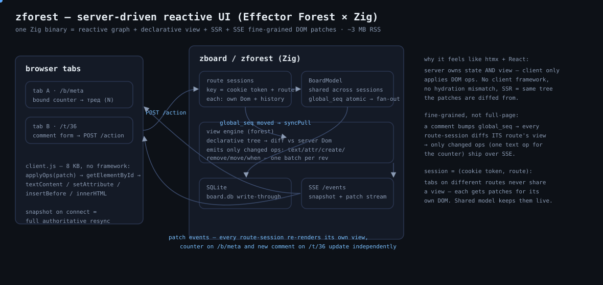

# zforest

Server-driven UIs in Zig: the `zefx` reactive graph core plus `forest`, a
fine-grained DOM patch layer, served by a minimal `std.http` server with a
vanilla JS patch client. This repo is the **framework**; the example apps
(todo, board, dashboard, booking, zmeta demo) live in
[zforest-examples](https://github.com/neolite/zforest-examples).

## Modules

`src/` is pure framework, exposed as named Zig modules:

- **`zefx`** (`src/zefx/`) — the reactive graph core: stores, events,
  two-phase flush (pure → effects), derived stores (`map`/`sample`/
  `combine`), generational subscription slots, `watchCtx`.
- **`forest`** (`src/forest/`) — the declarative view tree
  (`el`/`text`/`eachOf`/`computed`/`variant`/`when`), SSR
  (`writeHtml`), DOM-patch `diff`, full-state snapshot ops, and
  `bindTree` live bindings (store → leaf patch ops, no rebuild).
- **`zserver`** (`src/server/`) — generic-over-`Session` HTTP/SSE
  server: cookie sessions, `POST /action` → ACK, `GET /events` → SSE
  stream, `History` retained-batch ring, `stream` snapshot serializer.
- **`zmeta`** (`src/zmeta/`) — file-routing meta-framework: `Session(Deps)`
  skeleton, `Env` render context, plus the std-only `gen.zig` /
  `scaffold.zig` codegen tools (`zig build gen` / `new-app` in an apps
  repo).
- **`zdb`** (`src/db.zig`) — typed wrapper over the vendored sqlite3
  amalgamation (`vendor/sqlite3`, official 3.54.1). Apps opt in per-exe;
  the framework never imports it.
- **`zassets`** (`src/assets.zig`) — embeds `client.js`/`style.css`.

<p align="center">
  
</p>

## Using the framework

Apps are separate Zig packages that depend on this repo:

```zig
// build.zig.zon
.zforest = .{ .path = "../zforest" },   // or a git URL once published
```

```zig
// build.zig — pull the named modules from the dependency
const zforest_dep = b.dependency("zforest", .{});
const zefx_mod = zforest_dep.module("zefx");
// … then wire .imports on each app module
```

See [zforest-examples](https://github.com/neolite/zforest-examples) for
five working apps (`zforest` todo, `zboard`, `zmon`, `zcar`,
`zmeta-demo`) and the `gen`/`new-app` codegen steps. Framework docs:
[docs/meta-framework.md](docs/meta-framework.md) (zmeta spec),
[docs/getting-started.md](docs/getting-started.md) (tutorial),
[ARCHITECTURE.md](ARCHITECTURE.md) (design decisions).

## Build & test

```sh
zig build        # module graph only — this repo ships no executables
zig build test   # all framework module + tool test targets
zig fmt --check  # zig fmt is the source of truth
```

## How it works

1. `GET /` creates a per-browser-session model keyed by
   `(cookie token, route)` (random `zfxb`/`zfxs` cookie,
   `HttpOnly; SameSite=Strict`) — tabs of one browser on different routes
   get independent views, and returns fully rendered HTML plus a
   per-session CSRF token in a `<meta>` tag.
2. The client opens `GET /events?r=<route>` (Server-Sent Events, cookie
   auth) and
   waits for the first `event: snapshot` before enabling any
   `data-on-submit` controls. Each snapshot is `{"rev","ops"}` — the
   declarative view serialized as a full-state ops array
   (`forest.writeSnapshotOps`): keyed parents as `html` ops, bound nodes
   as `attr`/`text` ops. Each `event: patch` (with `id: rev`) is
   `{"rev","patches"}`.
3. Interactions are declared in the view: `.on = .{ .click = "delete" }`
   emits `data-on-click="delete"` and `.arg` emits `data-arg`. Delegated
   document listeners in `client.js` (which has zero app knowledge) turn
   them into `POST /action` JSON — `{action, arg?, value?, fields?}`
   with an `X-Zforest-CSRF` header; `fields` carries a submitted form's
   named inputs. The server replies with an ACK `{"rev":N}` only —
   patches are never in the response body.
4. `Session.dispatch` validates the whitelisted action and emits a zefx
   event; reducers mutate the model in the **pure
   phase**, a settle loop propagates derived stores (`seq` → `remaining`),
   and an after-flush hook rebuilds the declarative view tree
   (`src/forest/view.zig`: `el`/`text`/`eachOf`/`computed`/`variant`/`when`
   nodes, with
   store-pointer bindings resolved lazily) and diffs it against
   the tracked DOM into a `PatchLog`. The same tree also renders the SSR
   page and the snapshot `ops` — one description, all outputs.
   Under the
   model mutex the batch is serialized once, published into the session's
   bounded history (64 batches / 2 MiB, oldest evicted), and every SSE
   subscriber of that session receives its own copy.
5. The client applies ops (`create`/`remove`/`move`/`text`/`attr`/`html`/`when`)
   with `<template>` parsing + `insertBefore` for creates (trusted
   server-generated HTML with escaped data), `textContent` for text,
   `innerHTML` for `html` state dumps, comment-marker ranges for `when`,
   and an attribute whitelist for `attr` ops. Patch batches with `rev <= lastRev`
   are ignored; a `snapshot` event resets state wholesale.

   Conditional subtrees use `variant`/`when` anchors: SSR always emits a
   `<!--z-when:ID-->` + `<!--/z-when:ID-->` comment pair (comments don't
   affect CSS selectors or sibling counts), and `Dom` tracks the mounted
   branch key per anchor. A branch-key change emits one idempotent `when`
   op carrying the new branch markup; same-branch edits recurse as normal
   attr/text ops. `.lid` anchors compose inside keyed rows (`row-N/sw`)
   and are purged with the row by `removeTracked`.

## Scope notes (deliberate)

- SSE resync: `EventSource` auto-reconnects on any drop; every fresh
  `/events` connection starts with a full `snapshot`, which always
  resyncs the DOM (simpler than Last-Event-ID replay). If a subscriber's
  cursor fell behind the retained history, the server sends a snapshot
  instead of patches. A `session_expired` event means the cookie's session
  is gone — the client stashes the draft and reloads once (loop-guarded).
- CSRF: `POST /action` requires either a matching `X-Zforest-CSRF` token or a
  same-origin `Origin`/`Host` pair; everything else is 403. No CORS headers
  are ever emitted, and the SSE token never appears in a URL.
- Concurrency: one task per connection via `std.Io.Group.concurrent`
  (a thread per connection — simple, not an event loop; bounded at 128 concurrent
  connections; admissions beyond the cap are closed before any HTTP
  headers are read). All session/model state is serialized by a
  `std.Io.Mutex` that is never held across network I/O or sleeps; the
  request body is read before the lock is taken. SSE workers poll the
  history every 50 ms in-process and emit a heartbeat comment ~every 10 s.
- Idle connections are not timed out (demo limitation); sessions cap at 32
  with FIFO eviction of the oldest — eviction while streaming produces
  `session_expired`.
- Queues and the patch arena can grow; there is no hard allocation bound —
  this is not a zero-allocation design.
- `zefx` core: two-phase flush (pure → effects) with generational
  subscription slots, `watchCtx`, cursor-drained queues, and after-flush
  hooks. See `src/zefx/root.zig` tests for semantics.

## Roadmap

Shipped: reactive core (`zefx`), declarative view + SSR + snapshot, SSE
patch transport, keyed lists, `when` branches, delegated events,
route-keyed sessions, cross-tab fan-out, **fine-grained live bindings**
(`forest.bindTree`: store → leaf patch ops with no view rebuild),
**client-keyed persistence pattern** (cookie → SQLite write-through,
survives eviction/restart), **zmeta** file-routing meta-framework with
codegen (`gen`/`new-app`), and five example apps in
[zforest-examples](https://github.com/neolite/zforest-examples).

Next, roughly in order:

- **Live-mode structure** — reactive keyed lists and multi-key
  variants; per-item reactive cells still deferred (see
  [ARCHITECTURE.md](ARCHITECTURE.md)).
- **Deploy hardening** — process supervisor on the VM, SSE fallback
  polling for hostile proxies.
