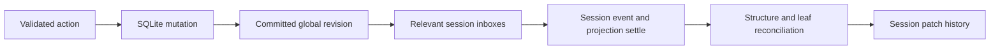

<!-- Astra (gpt-6-astra) review: two-tier graph / framework architecture Session: 01a1d426-ef09-7042-aafb-0a35dbff70b1 — read-only review of zefx+forest+server+apps. Summary recorded in ARCHITECTURE.md "Astra review: two-tier graph + snapshot catch-up bug".  -->

**The two-tier model is sound, but I would implement it as two independently scheduled graphs connected by a revisioned subscription module.** Ordinary `sample`/`combine` edges should remain inside one engine. Global commits should enqueue session work; they should not synchronously execute session rendering.

The main benefit comes from selective invalidation and coalescing. Moving `BoardModel` into a store, by itself, provides neither.

This assessment is based on static source inspection; I did not run tests or change files.

**1. Shared state needs an explicit transaction and delivery contract.**

[zefx/engine.zig](/Users/rafkat/Apps/tmp/zforest/src/zefx/engine.zig:91) settles one engine before notifying its watchers. That guarantee does not extend across engines:

- `Store.map` allocates its derived store in the **source engine**.
- `sample` installs reducer contexts into its source/clock event without verifying engine ownership.
- `combine` likewise installs contexts into source update events, but marks its target dirty without independently scheduling a target-engine flush.

Consequently, wiring a session-owned projection directly to global events can leave dangling reducer contexts after session destruction, fail to flush the session, or trigger nested flushes through other operator paths. See [store.zig](/Users/rafkat/Apps/tmp/zforest/src/zefx/store.zig:319), [sample.zig](/Users/rafkat/Apps/tmp/zforest/src/zefx/sample.zig:137), and [root.zig](/Users/rafkat/Apps/tmp/zforest/src/zefx/root.zig:399). I would explicitly reject mixed-engine ordinary operators.

The proposed flow should be:

SQLite belongs behind the mutation effect. Successful completion produces the committed event that updates global stores. Do not put database writes inside reducers. Today, `addPost` and `addComment` already execute the INSERT before appending in-memory state and bumping the counter; preserve that ordering when introducing the graph. See [board.zig](/Users/rafkat/Apps/tmp/zforest/src/board.zig:338).

For isolation, sessions receive read-only projection data or a read-only query capability. They submit validated commands to the global owner. Sharing a mutable `*Store` and relying on convention is a weak library contract.

Also decide what “session” means: [SessionStore](/Users/rafkat/Apps/tmp/zforest/src/server/http.zig:45) isolates `(cookie, route)`, **not browser tabs**. Two tabs on the same route still share `reply_to`, graph, DOM tracking, and history. Independent tab UI requires a separate view-instance identity.

For ordering, maintain two revisions:

- **Global revision:** committed shared-model state.
- **Session revision:** contiguous published batches, including local UI changes.

A session batch identifies the global revision it incorporated. Different sessions can reach that revision at different times. An ACK should not wait for every session to render.

I would relax “one batch per global revision” to **one coherent batch per session update, incorporating one complete global revision**. Requiring every intermediate revision conflicts with useful coalescing. If a session jumps from global revision 40 to 45, every projected field must reflect 45; it must not combine comments from 45 with counts from 43.

Initially, keep the current serialized ownership model. Later, rendering outside the mutex requires immutable snapshots or owned projection copies. `BoardModel.post()` returns pointers into a growing array; an asynchronous projection cannot safely retain those pointers across appends.

For lifecycle, distinguish **detachable subscriptions** from **detachable graphs**. Generational watcher handles already exist in [store.zig](/Users/rafkat/Apps/tmp/zforest/src/zefx/store.zig:121). A small global subscription per session can therefore be practical before arbitrary graph teardown exists. But teardown must:

- Remove the subscription under its owner’s serialization.
- Invalidate queued deliveries using session identity plus generation.
- Ensure no callback is executing before freeing its context.
- Destroy session bindings before their source stores.

Queued deliveries must own their payloads; `Event.emit` copies payload values, not the memory behind slices. Global tick-arena data cannot escape into a later session flush.

For back-pressure, use one pending-work record per session: latest revision plus accumulated invalidations. Repeated commits update that record instead of appending unlimited callbacks. On overflow of detailed invalidations, fall back to “recompute this projection.” Coalesce replaceable state; preserve commands and meaningful event occurrences.

Do this **before** DOM binding execution. `Dom.setText` deduplicates equal output, but formatting and watcher invocation have already happened. `Engine.flush` also scans every registered store during notification, and `Store.set` does not suppress equal values. Global subscriptions to M × K leaves would make those costs part of commit processing.

The existing bounded [history.zig](/Users/rafkat/Apps/tmp/zforest/src/server/history.zig:11) is a useful second line of defense. It bounds retained network history, not pending rendering work.

**Snapshot consistency deserves attention before this migration.**

There is a concrete current mismatch:

1. A route-session’s DOM/history represents shared state G.
2. Another session commits G+1.
3. A fresh SSE subscriber enters the initial-snapshot branch, which does **not** call `syncPull`.
4. Snapshot construction reads G+1 and advances `seen_seq`, but does not reconcile the session DOM or publish a new session revision.
5. Subsequent `syncPull` considers the session caught up.

This follows from [http.zig](/Users/rafkat/Apps/tmp/zforest/src/server/http.zig:434), [stream.zig](/Users/rafkat/Apps/tmp/zforest/src/server/stream.zig:12), and [board_app.zig](/Users/rafkat/Apps/tmp/zforest/src/board_app.zig:640).

An existing subscriber sharing that route-session can miss the update; subsequent diffs also start from tracking older than the new subscriber’s snapshot.

The rule should be: **catch up, reconcile, publish, then capture the snapshot and cursor atomically.** Snapshot serialization itself should not advance a shared consumption cursor.

For a subscription-based design, establish the subscription and capture its baseline revision under the same owner transaction. With asynchronous delivery, queue revisions after that baseline while the snapshot is being prepared. A revision counter alone does not make mutable reads consistent.

**2. The cheapest useful next step is selective projection invalidation.**

| Approach | Main benefit | Main cost | My choice |
|---|---|---|---|
| Direct cross-engine graph edges | Familiar composition syntax | Scheduling, ownership, teardown become implicit | Reject |
| Revisioned commits → session projections | Explicit consistency and selective delivery | Subscription lifecycle and scheduling | Target design |
| Event log → projections | Replay and independent consumers | Retention, catch-up, projection recovery | Only when replay is needed |
| Polling + dependency versions | Smaller change, immediate render savings | Dependency completeness | First optimization |

An event log is compatible with two tiers; it describes how changes reach projections. I would start with bounded committed-change records or dependency versions, not make an append-only event log the authoritative database.

For board, useful dependency units are already apparent:

- Board post membership.
- Home latest-post membership.
- Comment count for a post.
- Thread comment membership.
- Children of a comment.
- Session reply target and identity.

A comment insertion changes a thread and its post count. It need not rebuild every board page. Start with conservative thread-level invalidation; refine to parent-comment membership if measurement justifies it.

Keep the 50 ms polling initially and compare relevant versions. That separates the benefit of avoiding work from the benefit of waking sooner.

Crucially, **skipping `diffNode` after rebuilding the entire tree saves too little**. Skip construction/query work through explicit, stable regions. Retained region data needs ownership outside the resettable render arena.

There is also a cheaper data-model improvement: [childIdx](/Users/rafkat/Apps/tmp/zforest/src/board.zig:319) scans all comments for each rendered comment node. Recursive thread rendering therefore repeatedly scans the global collection. Parent/post indexes and pagination can buy more than changing the notification mechanism. A graph does not repair expensive projection queries.

**3. Hybrid live+diff requires one reconciliation authority.**

The promising foundation is that live binders already call `Dom.setText`/`setAttr`, rather than appending patches behind the tracker’s back. Preserve that.

I would define the hybrid transaction as: settle session state → reconcile structure → resolve surviving dirty leaves → publish once. Live callbacks mark bindings dirty during a structural transaction; they do not independently mutate the patch stream.

The required invariants are:

- **One owner per property.** Diff and live paths must share the same current binding definition and tracked value.
- **Mount before leaf writes.** Replacement HTML contains current values and seeds matching tracking; redundant descendant writes can then disappear.
- **Unmount invalidates pending work.** Removed binders cannot affect a later node that reuses the same ID. Use mount generations.
- **Moves preserve identity; replacement changes identity.**
- **Persistent bindings own persistent inputs.** Scratch arenas hold formatting output, not retained branch descriptions.
- **Snapshots and incremental patches describe the same committed render state.**

Several current details prevent simply calling `diff` followed by `bindTree`:

[Dom.findBinding](/Users/rafkat/Apps/tmp/zforest/src/forest/dom.zig:84) matches only kind, node ID, and attribute name. If a rebuilt node switches from store A to store B—or changes its formatting function—the old subscription survives. Hybrid reconciliation needs binding replacement, not just duplicate detection.

[Binder.variant_nodes](/Users/rafkat/Apps/tmp/zforest/src/forest/view.zig:900) borrows the branch tree. Capturing it from a per-render arena and then resetting that arena creates a lifetime bug.

[removeTracked](/Users/rafkat/Apps/tmp/zforest/src/forest/dom.zig:267) removes prefix-matching texts, attrs, branch states, and binders, but **does not remove nested keyed-list orders**. Absolute descendant IDs also escape prefix cleanup. The source explicitly acknowledges absolute IDs in the diff branch path; that allowance is unsafe for live subscription ownership. Require scoped IDs initially, or track explicit subtree ownership.

One documentation discrepancy matters here: [when()](/Users/rafkat/Apps/tmp/zforest/src/forest/view.zig:226) eagerly evaluates its condition into `"on"`/null. It does not preserve a live condition binding. The live mount/unmount test uses `variant(..., &flag, ...)`. The live capability is narrower than the architecture prose suggests.

Before hybrid release, exercise binding-source replacement, nested keyed-list unmount/remount, simultaneous structural and leaf changes, and snapshot-followed-by-diff against an actual client DOM.

**4. A small client-local primitive is worthwhile.**

Server authority should cover domain facts and accepted commands. It need not cover focus, disclosure state, character counts, selection, or an unsent draft.

The client already owns drafts, readiness, focus, error display, and form clearing in [client.js](/Users/rafkat/Apps/tmp/zforest/src/client.js). Strict passivity is already an approximation.

I would add only a fixed vocabulary of local behaviors, preferring native browser behavior where possible. Define ownership explicitly: a local character counter owns its output; the server does not patch that same text. Local disclosure state survives keyed moves and resets on replacement unless persistence is explicitly supported.

Do not introduce arbitrary expressions, a second general-purpose graph, local pricing rules, or mirrored domain stores. Server validation remains authoritative. The difficult part is competing DOM writers, not the existence of local state.

**5. Harden semantic contracts before splitting packages.**

My priority order would be:

1. **Snapshot/revision correctness and protocol parity.** Fix the catch-up issue. The server can emit arbitrary attribute patches, while the client accepts a small whitelist. Even the live `data-x` unit test produces an attribute the browser ignores. Client patch failures currently log errors and still allow revision advancement; define recovery.
2. **Engine ownership and transaction semantics.** Reject mixed-engine edges, define batching/reentrancy, document payload lifetimes, and distinguish synchronous effects from future asynchronous execution. Current `Effect.run` executes its handler synchronously during flush.
3. **Binding lifecycle and identity.** Address subtree cleanup, rebinding, retained-tree ownership, and cancellation before hybrid rendering or per-item cells.
4. **Projection delivery.** Add dependency-aware invalidation, bounded scheduling, and global/session revision separation.
5. **Package interfaces and resource budgets.** Hide history publication and render-arena choreography behind a smaller session interface. Make session/connection limits configurable; bound pending work and define shutdown behavior.

Keep `zefx` independent of DOM and persistence. Keep `forest`’s duck-typed binding interface independent of `zefx`. Keep SQLite in an application adapter. The server should own transport and session scheduling, not require every application to repeat publication invariants.

Deliberately defer distributed graphs, transparent cross-engine operators, durable event sourcing, arbitrary per-item graph teardown, a client expression language, and write-behind persistence. None is necessary to demonstrate the proposed design on board.

The first milestone I would choose is **correct snapshots plus revisioned, dependency-aware session projections while retaining diff rendering**. That establishes the hard contracts and produces measurable savings before hybrid rendering adds another lifecycle.

No files were changed. [AGENTS.md](/Users/rafkat/Apps/tmp/zforest/AGENTS.md) requires that “Any design discussion must be summarized there before the session ends”; this environment is read-only, so I could not append this review to `ARCHITECTURE.md`.
